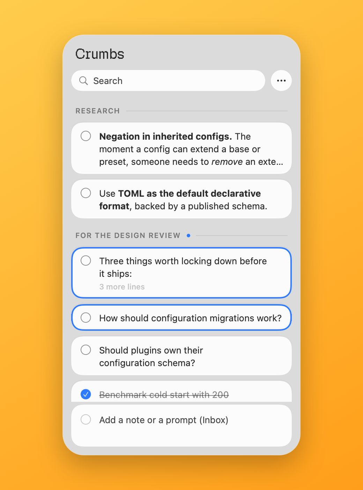
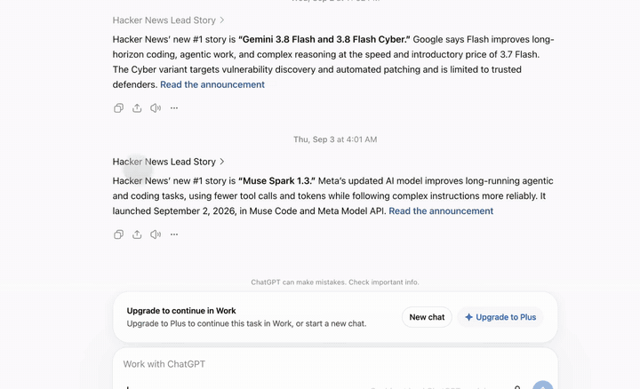
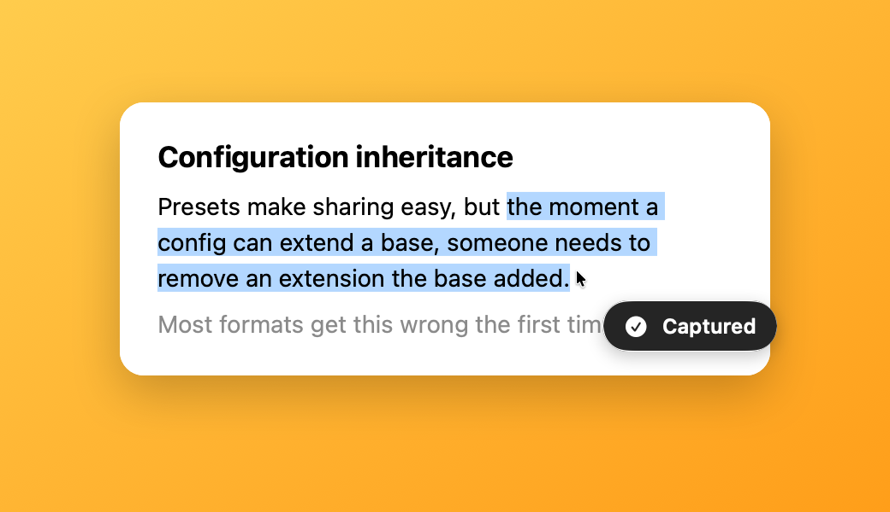
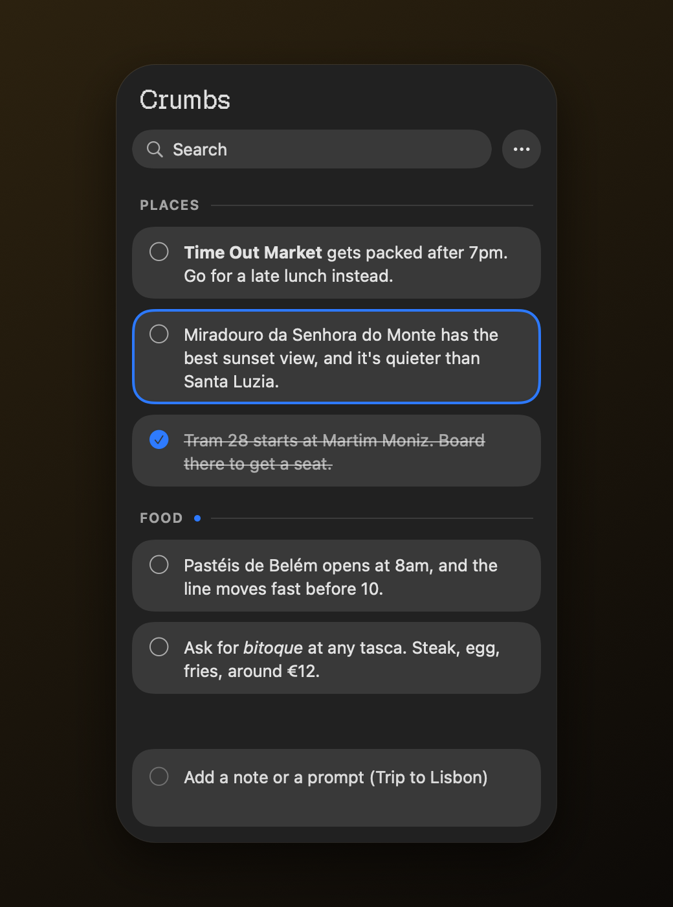
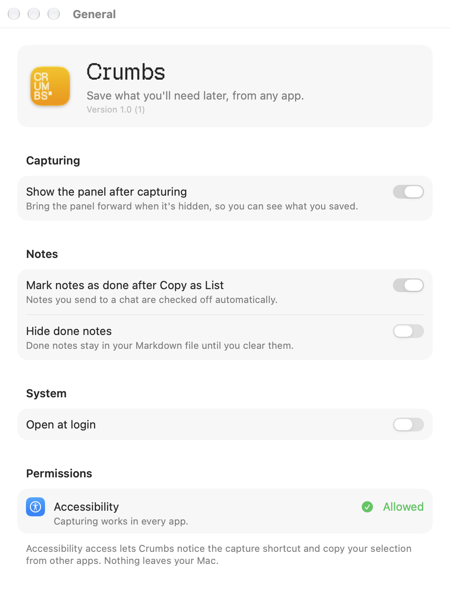
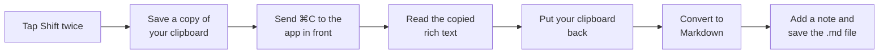

<p align="center">
  
</p>

<h1 align="center">Crumbs</h1>

<p align="center">
  Save the bits of text you'll need later, from any app on your Mac.<br>
  Select text, tap <kbd>Shift</kbd> twice, done.
</p>

---

Crumbs is a menu bar app for macOS. It keeps a floating panel on the side of your screen. Select text in any app and tap Shift twice, and the selection lands in the panel as a note. When you're ready to use your notes, select a few and press <kbd>⇧⌘C</kbd>. They go to the clipboard as a numbered list you can paste straight into a chat.

It's made for collecting questions and snippets while you read, then sending them to a chat in one go. It works for anything else you'd normally keep in a scratch file, too.

Your notes are plain Markdown files on your disk. There's no account and no sync service, and nothing leaves your Mac.

<p align="center">
  
</p>

## Contents

- [What it looks like](#what-it-looks-like)
- [How it works](#how-it-works)
- [Using it](#using-it)
- [Storage](#storage)
- [Permissions](#permissions)
- [Building](#building)
- [How it's put together](#how-its-put-together)
- [Tests](#tests)
- [Branding](#branding)
- [License](#license)

## What it looks like

<table>
  <tr>
    <td width="50%"></td>
    <td width="50%"></td>
  </tr>
  <tr>
    <td><b>Capture.</b> Select text anywhere and tap Shift twice. A "Captured" pill appears next to the pointer.</td>
    <td><b>Lists and sections.</b> Keep a list per project. The panel follows light and dark mode.</td>
  </tr>
</table>

<p align="center">
  
</p>

## How it works

When you double-tap the capture key, Crumbs asks the app in front to copy the selection, the same as if you pressed <kbd>⌘C</kbd> yourself, then puts your clipboard back. At the same moment it notes where the selection came from: the app, the window title, and the page or document link when the app shares one. That's saved with the note in your Markdown file, and you can turn it off in Settings.



Step by step:

1. **Spotting the double tap.** Crumbs watches modifier keys system-wide. Each tap has to be released within 0.35 seconds, and the two taps have to land within 0.45 seconds of each other. Pressing any other key, clicking, or scrolling in between cancels it, so Shift held for a capital letter never counts.
2. **Copying.** Crumbs saves everything on the clipboard, every type and every item, then sends the front app a synthetic <kbd>⌘C</kbd>. It waits up to half a second for the clipboard to change.
3. **Restoring.** It reads the copied RTF or HTML, then puts your original clipboard back before doing anything else. If a slow app answers the copy late, Crumbs keeps watching for another 1.5 seconds and restores the clipboard then too.
4. **Converting.** Bold, italics, inline code, links and lists from the source become Markdown. If the app didn't copy anything, Crumbs falls back to asking for the selected text through the Accessibility API.
5. **Saving.** The note goes into the panel right away. Crumbs writes the list's `.md` file 300 milliseconds after your last change, so a burst of edits becomes one write.

## Using it

Select text anywhere and tap Shift twice. You can also type into the box at the bottom of the panel, or paste with <kbd>⌘V</kbd>.

Notes live in sections. New notes go to the section marked with a dot, which is the last one unless you click another header. Drag notes to reorder them, or use the context menu to move them between sections. The **…** menu at the top of the panel switches lists, adds sections, and clears done notes.

The panel doesn't steal focus. You can click into it and type while the app you're reading stays in front.

### Keyboard

Everywhere:

| Shortcut | Action |
| --- | --- |
| <kbd>Shift</kbd> <kbd>Shift</kbd> | Capture the selection. You can switch this to Command, Option or Control in Settings. |
| <kbd>⌃⌥C</kbd> | Show or hide the panel. You can change this in Settings. |

In the panel:

| Shortcut | Action |
| --- | --- |
| <kbd>↑</kbd> <kbd>↓</kbd>, <kbd>⇧↑</kbd> <kbd>⇧↓</kbd> | Move or extend the selection |
| <kbd>Space</kbd> | Mark as done |
| <kbd>↩</kbd> | Edit inline |
| <kbd>⌘↩</kbd> | Edit in a separate window |
| <kbd>⌘C</kbd> | Copy |
| <kbd>⇧⌘C</kbd> | Copy as a numbered list, and mark those notes done |
| <kbd>⇧⌘M</kbd> | Merge the selected notes |
| <kbd>⌥⌘↑</kbd> <kbd>⌥⌘↓</kbd> | Move notes up or down |
| <kbd>→</kbd> <kbd>←</kbd> | Expand or collapse a long note |
| <kbd>⌫</kbd> | Delete |
| <kbd>⌘V</kbd> | Paste the clipboard as a new note |
| <kbd>⌘N</kbd> | Focus the note box |
| <kbd>⌘F</kbd> | Search |
| <kbd>⌘Z</kbd>, <kbd>⇧⌘Z</kbd> | Undo, redo |
| <kbd>Esc</kbd> | Back out one step, then hide the panel |

## Storage

Each list is one Markdown file in `~/Library/Application Support/Crumbs/`. You can pick another folder in Settings › Storage. A list looks like this:

```markdown
## Research

- [ ] **Negation in inherited configs.** The moment a config can extend a base…
- [x] Three things worth locking down before it ships:
  1. A `version` field on the format.
  2. An effective-config command.
```

Headings are sections and task items are notes. Lines indented by two spaces belong to the note above.

You can edit these files in any editor while Crumbs is running, and it picks up the changes. If a file changes on disk while Crumbs has unsaved edits, Crumbs writes the other version to `<list> (Conflict <date>).md` before saving its own, so you never lose either copy. If Crumbs can't read a file, it leaves the file alone and tells you, instead of saving an empty list over it.

## Permissions

Crumbs needs Accessibility access, under System Settings › Privacy & Security › Accessibility. It asks on first launch, and the panel shows a reminder until you allow it. It uses the access for two things:

- noticing the double tap while another app is in front
- sending that app a Copy command so it can read your selection

That's also why the app isn't sandboxed. A sandboxed app can't watch keys across the system or copy from other apps. Hardened Runtime is on, so you can notarize it for distribution outside the App Store.

## Building

You need:

- macOS 27 or later
- Xcode 27

Open `Crumbs.xcodeproj` and run the Crumbs scheme, or build from the command line:

```bash
xcodebuild -project Crumbs.xcodeproj -scheme Crumbs -configuration Release build
```

The app lives in the menu bar and has no Dock icon. The panel shows up on the right edge of the main screen.

## How it's put together

| Folder | What's in it |
| --- | --- |
| `Crumbs/Capture` | The double-tap detector, global hot keys (Carbon), the copy-and-restore capture, and rich text to Markdown conversion |
| `Crumbs/Model` | Notes and sections, the Markdown reader and writer, the store (undo, debounced saves, conflict copies), and the file watcher |
| `Crumbs/Panel` | The floating `NSPanel`, the keyboard router, the "Captured" HUD, and `PanelModel`, which holds selection, editing and focus |
| `Crumbs/Views` | SwiftUI for the panel: header, note rows, sections, the note box, and the editor window |
| `Crumbs/Settings` | Preferences and the Settings window (toolbar panes built on `NSTabViewController`) |
| `Crumbs/Support` | Branding (the Geist Pixel wordmark and menu bar icon) and small modal prompts |
| `Crumbs/Fonts` | Geist Pixel, bundled so the wordmark works on any Mac |

A few choices worth knowing about:

- The panel is a non-activating `NSPanel`. It takes keyboard input without pulling the app you're reading out of the foreground.
- Panel shortcuts go through an `NSEvent` monitor rather than SwiftUI, so <kbd>⌘F</kbd> and <kbd>⌘N</kbd> work even while a text field has focus.
- Settings uses `NSTabViewController` instead of SwiftUI's `Settings` scene, because a menu bar app can't open that scene reliably.

The project uses Swift 6 with main-actor default isolation.

## Tests

```bash
xcodebuild -project Crumbs.xcodeproj -scheme Crumbs test
```

The unit tests use Swift Testing. They cover the Markdown format, rich text conversion, the store's save, conflict and undo rules, panel selection and editing, and the double-tap detector. Each test gets its own temporary folder, defaults and pasteboard, so nothing touches your real notes.

The UI test launches the app with `-uiTesting`, which skips the global hot key and key monitors. It adds a note through the panel and checks that the note reaches the Markdown file.

## Branding

Crumbs uses [Geist Pixel](https://github.com/vercel/geist-pixel-font) for its wordmark, at the top of the panel and in Settings. The font file is `Crumbs/Fonts/GeistPixel.ttf`. `Brand.swift` registers it for the app's process when it's first needed, so it doesn't need to be installed. Geist Pixel is licensed under the SIL Open Font License.

The menu bar icon is the pixel asterisk from the app icon, drawn in code as a 9×9 grid in `Brand.menuBarIcon`. It's a template image, so macOS tints it for light and dark menu bars. Each grid cell is sized to whole screen pixels so the edges stay sharp on both Retina and non-Retina displays.

The app icon is `Crumbs/AppIcon.icon`, an Icon Composer document. It sets "CR / UM / BS*" in Geist Pixel on a yellow gradient. `Scripts/make_app_icon.py` generated the first version, using `Scripts/text_paths.swift` to turn the letters into vector paths. The icon has been adjusted by hand in Icon Composer since then, and running the script again would undo those adjustments. Make further changes in Icon Composer.

The screenshots in `docs/images` come from the app's own SwiftUI views, rendered offscreen with sample notes.

## License

Crumbs is released under the MIT License. See [`LICENSE`](LICENSE).

The bundled Geist Pixel font keeps its own license, the SIL Open Font License. The website in `website/` started from a GPL-3.0 template and keeps that license. See [`website/README.md`](website/README.md).
